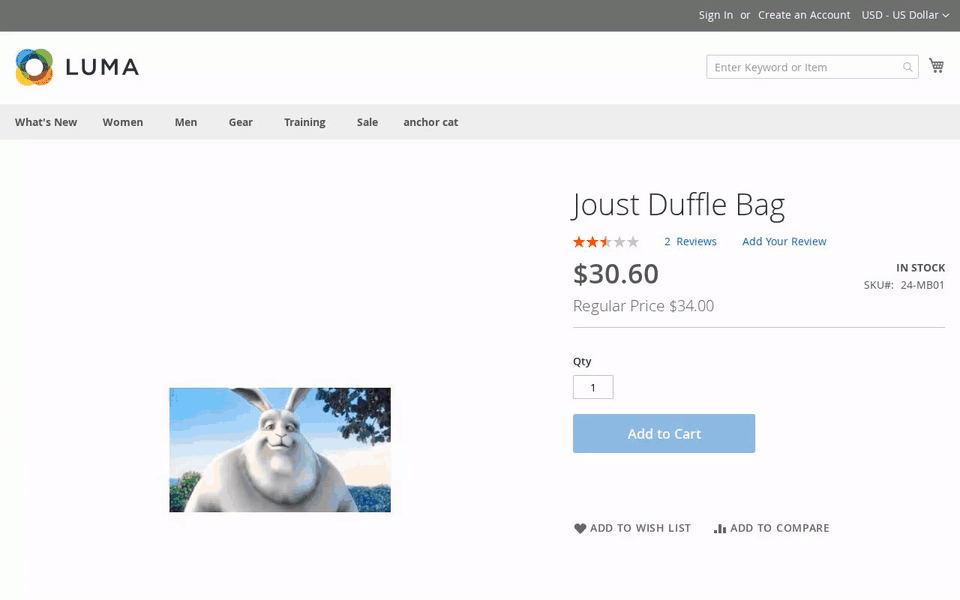
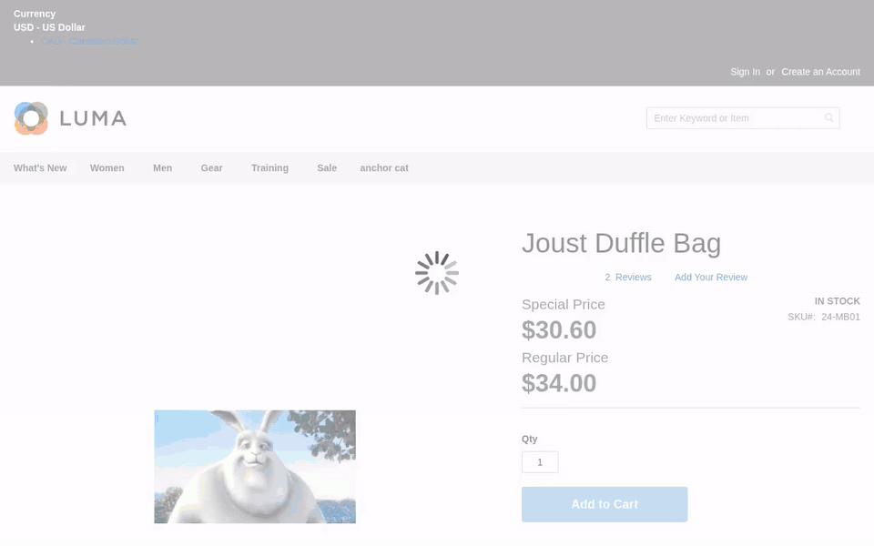
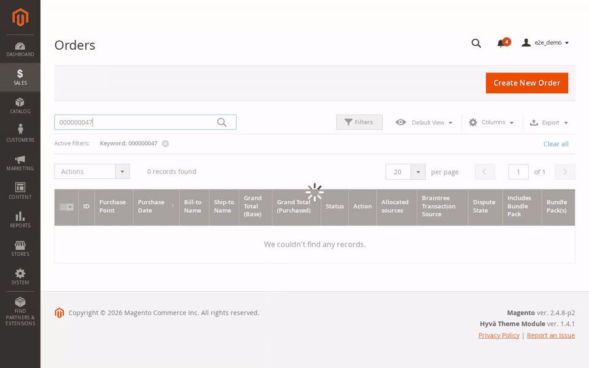
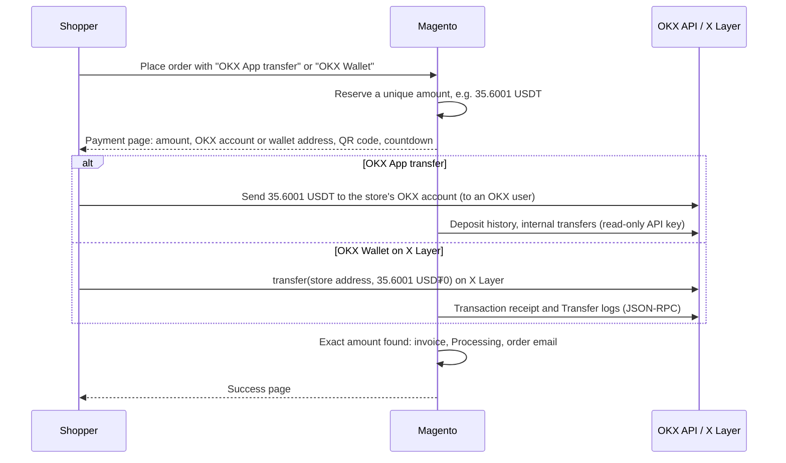

# OKX Crypto Payment Gateway for Magento 2 (OKX App & X Layer)

**Magento 2 OKX Pay** is an open-source payment extension that lets a Magento 2 / Adobe Commerce 2.4 store
**accept USDT, USDC and USDG from OKX users**, in two ways that can be offered side by side:

- **OKX App transfer**: the shopper sends USDT (or USDC) from the OKX app to the store's OKX account. OKX credits
  transfers between OKX users instantly and without network fees
  ([OKX help](https://www.okx.com/en-sg/help/internal-withdrawal)). A **read-only** OKX API v5 key finds the
  transfer.
- **OKX Wallet on X Layer**: the shopper pays USD₮0 or USDG on X Layer (chain ID 196) straight to the store's
  wallet address, in one tap from OKX Wallet or by scanning the QR code. The module reads the transfer from the
  chain; the server never holds a private key.

Each order gets its own amount (the total plus 0.0001 to 0.0999, e.g. $35.60 becomes **35.6001 USDT**), so a
payment is matched to its order without a memo, and the order is invoiced automatically.

**Setting it up for the first time?** The [step-by-step setup guide](docs/setup-guide.md) walks a store owner
through it with screenshots and a 3-minute video: where to get the API key, UID and wallet address, where to paste
them in Magento, a $1 test order, and what shoppers see.

| Shopper: OKX App transfer | Shopper: OKX Wallet on X Layer |
| --- | --- |
|  |  |

| Merchant: the paid order in the admin |
| --- |
|  |

<sub>Recorded on Magento 2.4.8-p2 (Luma) against the bundled OKX and X Layer mock server, so no real funds moved;
the wallet is a simulated stand-in for OKX Wallet. MP4 versions: [app](docs/okx-pay-app-checkout.mp4),
[wallet](docs/okx-pay-wallet-checkout.mp4), [admin](docs/okx-pay-admin-order.mp4).</sub>

## Features

- **Two payment methods**, enabled separately: *OKX App Transfer* and *OKX Wallet on X Layer*.
- **Unique amount per order**: 4 decimals tell the orders apart. An amount stays reserved for 24 hours after its
  order stops waiting, so a late or repeated transfer is never taken as payment for someone else's order.
- **Payment page** with the amount and the account or address (copy buttons), a QR code, a countdown and a live
  status that turns green by itself when the money arrives.
- **One-tap OKX Wallet**: the page connects the wallet, switches it to X Layer (adding the network if needed) and
  prepares the token transfer with the exact amount; the shopper only confirms.
- **Automatic invoicing**: a paid order moves from *Pending Payment* to *Processing* with an invoice and the order
  email, whether the shopper waits on the page or closes the browser (a cron job checks every minute).
- **No access to your funds**: the app method needs an API key with the *Read* permission only, and the wallet
  method only your public address.
- **Careful matching**: exact amount, accepted coin or token, sent after the order was placed, each OKX deposit or
  X Layer transfer used once, and a configurable number of block confirmations on X Layer.
- **Late payments are flagged**: money that arrives after an order was cancelled is not lost; the order gets a
  comment with the amount, reference and sender so you can refund or fulfil it.
- **Cancel and retry**: a shopper who cancels on the payment page goes back to the cart with the items restored.
- Any store currency with a US dollar rate, country and order-total restrictions, debug log.

## How it works



While the payment page is open it asks the store for the status every few seconds; the store looks for the payment
at most every 10 seconds per method, and the cron job does the same every minute for shoppers who left the page.

| OKX payment | Magento order |
| --- | --- |
| Pending, inside the payment window | stays *Pending Payment* |
| Paid: the exact amount arrived | invoiced, *Processing*, order email sent |
| Expired: the window ended without payment | *Canceled* |
| Canceled by the shopper on the payment page | *Canceled*, cart restored |
| Late: the money arrived after the order was cancelled | stays *Canceled*, with a comment to refund or fulfil it |

## Requirements

- Magento Open Source or Adobe Commerce 2.4.x, PHP 8.1 to 8.4 with `bcmath` and `json`. Tested on Magento 2.4.8-p2
  with PHP 8.3.
- Magento cron running (`bin/magento cron:run` every minute).
- The Luma checkout (also used by Hyvä themes through the Luma checkout fallback). Hyvä Checkout (Magewire) needs a
  separate compatibility module, which is not included.
- For **OKX App Transfer**: an OKX account for the store and an API key of that account with the *Read*
  permission only, created in the API section of your OKX account. Note the passphrase you choose; binding the key
  to your server's IP address is recommended.
- For **OKX Wallet on X Layer**: an EVM address you control, for example an OKX Wallet account. Shoppers pay the
  network fee in OKB on X Layer.

## Installation

Composer, from this repository:

```bash
composer config repositories.joepham-okx-pay vcs https://github.com/ph4mHoa/magento2-okx-pay
composer require joepham/module-okx-pay:dev-main
bin/magento module:enable JoePham_OkxPay
bin/magento setup:upgrade
bin/magento setup:di:compile            # production mode
bin/magento setup:static-content:deploy # production mode
bin/magento cache:flush
```

Or copy the files to `app/code/JoePham/OkxPay`, run `composer require bacon/bacon-qr-code` if your store does not
have it yet, and run the same `bin/magento` commands.

## Configuration

**Stores > Configuration > Sales > Payment Methods > OKX App Transfer**

| Setting | Notes |
| --- | --- |
| Enabled, Title | Show the method at checkout, under this name. |
| OKX Account Shown to Shoppers | The email, phone number or UID that shoppers send the transfer to. |
| API Key / API Secret / API Passphrase | A *Read* key of that same OKX account. Stored encrypted. |
| API URL | `https://openapi.okx.com` for global accounts; accounts on a regional OKX site use its domain, e.g. `https://eea.okx.com` or `https://us.okx.com`. |
| Accepted Coins | USDT, USDC; priced 1:1 in US dollars. |
| Payment Window (minutes) | Unpaid orders are cancelled after this time (default 30). |
| Countries, Minimum / Maximum Order Total, Sort Order | As for any payment method. |
| Debug | Logs OKX API calls to `var/log/joepham_okxpay.log`. |

**Stores > Configuration > Sales > Payment Methods > OKX Wallet on X Layer**

| Setting | Notes |
| --- | --- |
| Enabled, Title | Show the method at checkout, under this name. |
| Receiving Wallet Address | `0x` followed by 40 hex characters. Only the address, never a private key. |
| Accepted Tokens | USD₮0, USDT, USDG, USDC on X Layer (default USD₮0 and USDG). |
| X Layer RPC URL | Default `https://rpc.xlayer.tech`. A provider URL with a key is never shown to shoppers. |
| Confirmations | Blocks to wait before a transfer counts (default 3; X Layer makes about one block per second). |
| Blocks per Log Query | Default 100, the public RPC's limit for `eth_getLogs`. |
| Payment Window, Countries, Order Totals, Sort Order, Debug | As above. |

The API credentials, the OKX account and the wallet address are set once for the whole installation (default
scope).

## Good to know

- **The exact amount matters.** The shopper must send exactly the amount shown, to 4 decimals. A transfer of
  another amount, coin or network is not matched to any order: it stays in your OKX account or wallet, and you
  sort it out with the shopper.
- **Prices are in US dollars, 1 coin = 1 dollar.** Orders in another currency are converted with the store's US
  dollar rate (*Stores > Currency Rates*); without a rate, the methods are hidden at checkout.
- **Only X Layer.** The wallet method watches X Layer only; a transfer on Ethereum, Tron or another network is not
  seen.
- **Late money is flagged, not invoiced.** Once an order is cancelled its stock is released, so a payment that
  arrives later is recorded on the order for you to decide. A second transfer for an order that is already paid is
  not recorded in Magento; check your OKX deposit history or wallet.
- **Refunds are offline.** Send the coins back from OKX or your wallet, then create an offline credit memo.
- The payer's OKX account (as masked by OKX) or wallet address is kept on the order and shown in the admin only.

## Testing without an OKX account

OKX has no sandbox for this: demo trading does not support deposits and withdrawals
([OKX API documentation](https://www.okx.com/docs-v5/en/), *Demo Trading*), and the wallet method watches X Layer
mainnet (chain ID 196) only. The module therefore ships a mock server that behaves like the OKX API v5 deposit
history (it checks the request signatures the way OKX does) and like an X Layer JSON-RPC node (a chain that grows by
one block per second), so both methods can be tried end to end without real funds. Before going live, also pay one
small real order, as described in the [setup guide](docs/setup-guide.md#5-test-with-a-small-real-order).

```bash
# 1. Start the mock (several workers, so page polls and cron can run at the same time)
MOCK_API_KEY=mock-key MOCK_API_SECRET=mock-secret MOCK_API_PASSPHRASE=mock-pass PHP_CLI_SERVER_WORKERS=4 \
    php -S 127.0.0.1:8703 app/code/JoePham/OkxPay/Test/Mock/okx-mock.php

# 2. Point a development store at it
bin/magento config:set payment/joepham_okx_app/api_url http://127.0.0.1:8703
bin/magento config:set payment/joepham_okx_app/api_key mock-key
bin/magento config:set payment/joepham_okx_app/api_secret mock-secret
bin/magento config:set payment/joepham_okx_app/api_passphrase mock-pass
bin/magento config:set payment/joepham_okx_app/recipient payments@example.com
bin/magento config:set payment/joepham_okx_app/active 1
bin/magento config:set payment/joepham_okx_wallet/address 0x9a3f0c2e5b7d41c8e6f2a1b0d4c7e9f3a5b8c1d2
bin/magento config:set payment/joepham_okx_wallet/rpc_url http://127.0.0.1:8703/rpc
bin/magento config:set payment/joepham_okx_wallet/active 1
bin/magento cache:flush

# 3. Unit tests
vendor/bin/phpunit -c dev/tests/unit/phpunit.xml.dist app/code/JoePham/OkxPay/Test/Unit

# 4. End-to-end checkout (Playwright for Python): app, wrong amount, cancel, late payment, wallet, log scan, admin
python3 app/code/JoePham/OkxPay/Test/E2E/okx_pay_e2e.py --base https://magento.test \
    --magento-root "$PWD" --product joust-duffle-bag.html --admin-user <admin> --admin-password <password>
```

`POST /mock/deposit` (`ccy`, `amt`, `from`) makes an internal transfer arrive in the OKX account and
`POST /mock/transfer` (`token`, `to`, `amount`) mines a token transfer; `/mock/state` shows everything. The
end-to-end test injects a simulated wallet into the page in place of OKX Wallet. Never point a live store at the
mock.

## Troubleshooting

- **OKX error 50113 (invalid sign) or 50105 (passphrase)**: the API secret or passphrase is wrong.
- **OKX error 50111 (invalid key)**: the API key is wrong. Accounts on a regional OKX site must use that site's
  API URL.
- **OKX error 50102 (timestamp expired)**: the server clock is off; keep it in sync with NTP.
- **An IP allowlist error**: add your server's outgoing IP address to the API key.
- **Order stays Pending Payment after the shopper paid**: check the amount and coin or token in your OKX deposit
  history or on the explorer, check that Magento cron runs, then enable Debug and read
  `var/log/joepham_okxpay.log`.
- **No "Pay with OKX Wallet" button**: the button appears when the browser has OKX Wallet (or another wallet that
  injects `window.ethereum`); without one, shoppers scan the QR code or copy the address.
- **"Too many payments for this amount are open"**: all 999 amounts for this order total are reserved, which needs
  999 open or recent orders of the same total; the shopper can try again later.

## Related

- [Binance Pay Payment Gateway for Magento 2](https://github.com/ph4mHoa/magento2-binance-pay): accept USDT, USDC,
  BTC, BNB and more through the Binance Pay hosted checkout.

## License

[MIT](LICENSE)

*This is an independent open-source project and is not affiliated with, endorsed by or sponsored by OKX or Adobe.
"OKX", "OKX Wallet", "X Layer", "Magento" and "Adobe Commerce" are trademarks of their respective owners.*
