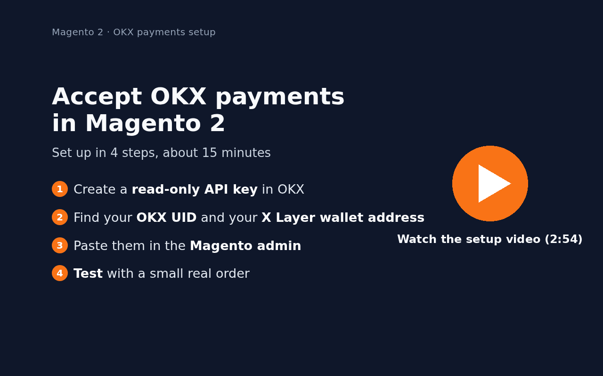
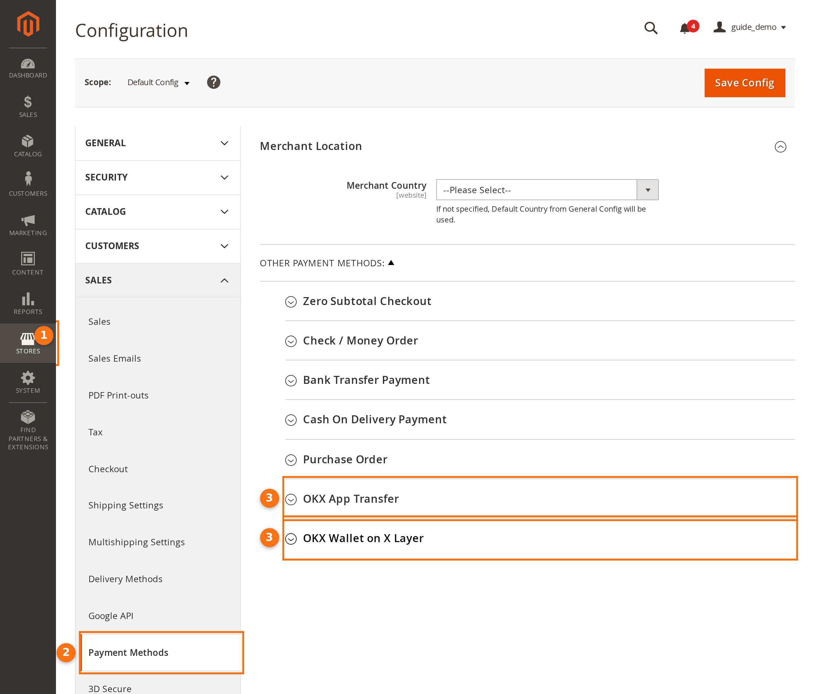
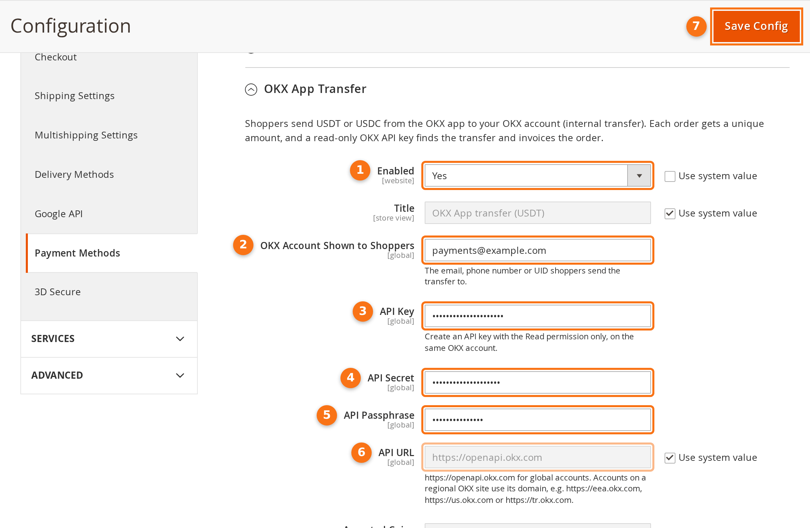
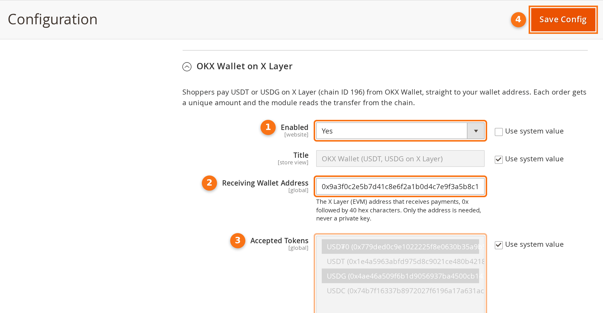
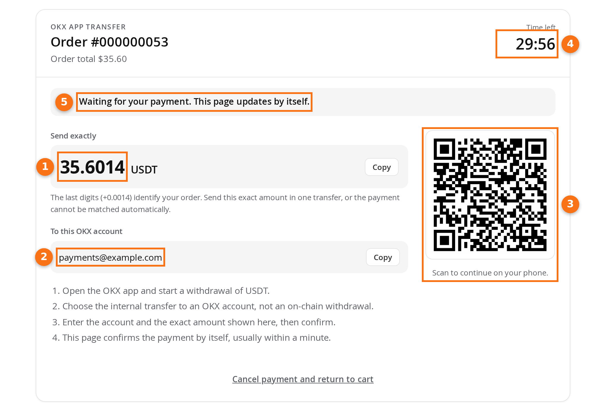
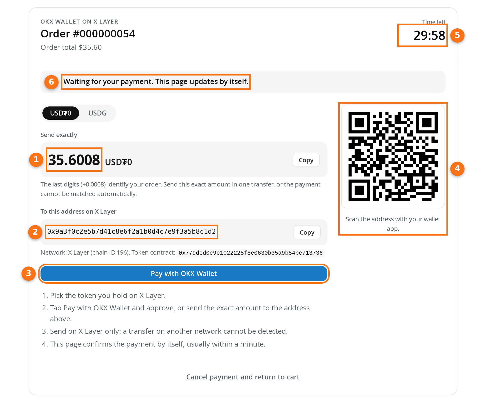

# Set up OKX payments in Magento 2: step-by-step guide

This guide is for store owners and needs no coding. It shows where to get each value in OKX, where to paste it in
Magento, how to check everything with a $1 order, and what your shoppers see. Your developer installs the extension
first ([installation](../README.md#installation)).

The video and screenshots were made on a test store connected to the extension's test server, so no real money
moved. Values such as `payments@example.com` are placeholders: use your own.

1. [What you need](#1-what-you-need)
2. [Create a read-only API key](#2-create-a-read-only-api-key-okx-app-transfer)
3. [Find your UID and wallet address](#3-find-your-uid-and-wallet-address)
4. [Settings in Magento](#4-settings-in-magento)
5. [Test with a small real order](#5-test-with-a-small-real-order)
6. [What your shoppers see](#6-what-your-shoppers-see)
7. [Everyday use](#7-everyday-use)

## 1. What you need

| For | You need |
| --- | --- |
| Both methods | Access to the Magento admin. Magento cron running every minute (ask your developer or host). A US dollar exchange rate if your store currency is not USD (*Stores › Currency Rates*). |
| OKX App Transfer | An OKX account for the store, with identity verification done. A personal account works; OKX has no separate merchant account. In some regions OKX lets an account create API keys only when it holds at least 100 USD in assets ([OKX API FAQ](https://www.okx.com/help/api-faq)). |
| OKX Wallet on X Layer | OKX Wallet (in the OKX app under *Web3*, or the browser extension), or any wallet with an address starting with `0x` that you control. |

You can turn on one method or both.

## 2. Create a read-only API key (OKX App Transfer)

Magento uses this key to read your OKX deposit history and spot the shopper's transfer. With the *Read* permission
only, the key cannot trade or move money.

1. On a computer, log in at [okx.com](https://www.okx.com). If your account is on a regional OKX site (for example
   the European or US site), log in there instead.
2. Open the profile menu at the top right, choose **API and connections**, then **Create API key**. In the app:
   menu › **API** › **Create API key** ([OKX API FAQ](https://www.okx.com/help/api-faq)).
3. Fill in the form:

   | Field | Enter |
   | --- | --- |
   | Name | Something you will recognise, such as `Magento store` |
   | Purpose (if asked) | API trading |
   | Passphrase | A passphrase of your choice. **Write it down**: OKX cannot recover it. |
   | Permissions | **Read** only. Leave *Trade* and *Withdraw* unticked. |
   | IP address | Optional but recommended: your server's outgoing IP address (ask your developer). |

4. Confirm with your security verification. Copy the **API key** and the **secret key** to a safe place, such as a
   password manager, together with the passphrase. The secret key is shown only once.

Menu names can differ a little by region and app version. From the
[OKX API documentation](https://www.okx.com/docs-v5/en/) (section *API key Creation*): keys with the *Trade* or
*Withdraw* permission and no IP address expire after 14 days without use; a *Read*-only key is not affected. One
key can be bound to up to 20 IP addresses.

## 3. Find your UID and wallet address

### Your OKX UID (OKX App Transfer)

Shoppers send their transfer to this account, and the payment page shows it to them. Use your UID: unlike your email
address or phone number, it tells strangers nothing about you.

- **In the app**: open the menu in the corner to reach the User Center, then *Account settings*. Your UID is in the
  *Profile* section, with a copy button.
- **On the web**: hover over the profile icon. Your UID is in the menu, and under *Profile › Personal info*.

([OKX help: How do I find my user ID (UID)?](https://www.okx.com/help/how-do-i-find-my-user-id-uid))

### Your wallet address (OKX Wallet on X Layer)

1. In the OKX app, switch to **Web3** at the top.
2. Tap **Receive**, then choose **USDT** (or USDG) and the **X Layer** network.
3. Copy the address. It starts with `0x` and is 42 characters long.

([OKX help: How do I manage my assets in my OKX wallet?](https://www.okx.com/help/how-do-i-manage-my-assets-in-my-okx-wallet-app))

> [!WARNING]
> Never type your recovery phrase (seed words) or private key into Magento or any website. The store only needs your
> address, which is public. Anyone who asks for your recovery phrase is trying to take your money.

You do not need OKB to receive payments: the shopper pays the network fee.

## 4. Settings in Magento

In the Magento admin, go to **Stores › Configuration**, then **Sales › Payment Methods**. The two OKX methods are near
the bottom, under *Other Payment Methods*.

### OKX App Transfer

Open **OKX App Transfer** and fill in:

| # | Setting | What to do |
| --- | --- | --- |
| 1 | Enabled | Untick *Use system value*, then choose **Yes**. |
| 2 | OKX Account Shown to Shoppers | Your UID (section 3). The account's email address or phone number also works. |
| 3–5 | API Key, API Secret, API Passphrase | The three values from section 2. Magento stores them encrypted. |
| 6 | API URL | Keep `https://openapi.okx.com`, unless your account is on a regional OKX site. Then use that site's address, such as `https://eea.okx.com` (Europe) or `https://us.okx.com` (US and Australia). |
| 7 | Save Config | The orange button at the top right. |

Further down, all optional: *Title* (the name shown at checkout), *Accepted Coins* (USDT; you can add USDC),
*Payment Window* (30 minutes by default), countries, and minimum or maximum order total.

### OKX Wallet on X Layer

Open **OKX Wallet on X Layer** and fill in:

| # | Setting | What to do |
| --- | --- | --- |
| 1 | Enabled | Untick *Use system value*, then choose **Yes**. |
| 2 | Receiving Wallet Address | Your `0x…` address (section 3). |
| 3 | Accepted Tokens | USD₮0 and USDG are selected by default. Keep them. |
| 4 | Save Config | The orange button at the top right. |

Leave *X Layer RPC URL*, *Confirmations* and *Blocks per Log Query* as they are.

Then open your store in a private browser window, add a product to the cart and go to checkout. The methods you
turned on are listed with the other payment methods. If one is missing, check the US dollar rate (section 1), the
countries and the order total limits.

## 5. Test with a small real order

Do this once before you tell customers. Your store's OKX account receives the money, so to play the shopper you need
**a second OKX account** (a colleague's, for example) or **a second wallet**.

1. **Make a $1 test product.** Go to *Catalog › Products › Add Product › Virtual Product*. Name it "Payment test",
   set the price to `1`, the quantity to `10` and *Stock Status* to *In Stock*, then save. A virtual product needs no
   shipping, so the order total stays at $1. A new product can show *Out of stock* for a minute, until Magento has
   updated its indexes.
2. **Order it.** In a private browser window, add the product to the cart, check out, choose an OKX method and place
   the order. The payment page shows the amount to send, for example **1.0007 USDT**.
3. **Pay from the second account.**
   - **OKX App Transfer**: in the OKX app, go to **Assets › Withdraw › Withdraw crypto**, pick USDT, choose
     **OKX users**, then enter your UID and the exact amount shown, and confirm
     ([OKX help](https://www.okx.com/help/internal-withdrawal)). Transfers between OKX users arrive instantly and
     have no network fee.
   - **OKX Wallet**: the second wallet needs slightly more than the amount in USD₮0 or USDG on X Layer, plus a
     little OKB on X Layer for the network fee. To fill it from an OKX account, use
     **Web3 › Receive › Withdraw cryptos from Exchange** with the **X Layer** network. Then open the payment page in a
     browser with the OKX Wallet extension, click **Pay with OKX Wallet** and confirm.
4. **Check the result.** Within about a minute the payment page turns green and moves on to the "Thank you" page.
   In *Sales › Orders* the order is **Processing** (a virtual product goes straight to **Complete**). It has an
   invoice, and the order page shows the amount received, the OKX reference or transaction, and the payer.
5. **Tidy up.** Send the money back to the second account. Open the order, click **Credit Memo**, then
   **Refund Offline**. Disable the test product.

If the order stays *Pending Payment*, compare the amount and coin you sent with the payment page, then see
[Troubleshooting](../README.md#troubleshooting).

## 6. What your shoppers see

After *Place Order*, the shopper gets a payment page with everything they need. The page checks for the payment by
itself every few seconds; the shopper does not need to refresh it or contact you.

**OKX App Transfer**

1. **The exact amount**, with a copy button. The last digits (here +0.0014) identify the order, so a different amount
   is not matched.
2. **Your OKX account** to send it to, with a copy button.
3. **A QR code** that opens this page on the shopper's phone, to continue in the OKX app.
4. **Time left** to pay (the *Payment Window*). After that the order is cancelled.
5. **The status**, which turns green when the money arrives.

**OKX Wallet on X Layer**

1. **The exact amount**, in the token picked above it (USD₮0 or USDG).
2. **Your wallet address** on X Layer, with a copy button.
3. **Pay with OKX Wallet**, shown when the browser has OKX Wallet or another wallet extension. The wallet switches to
   X Layer and fills in the transfer; the shopper only confirms.
4. **A QR code of your address**, for paying from a wallet app on a phone. The shopper then types in the exact
   amount.
5. **Time left**, as above.
6. **The status**, as above.

The whole flow, recorded on the test store: [OKX App Transfer](okx-pay-app-checkout.gif) and
[OKX Wallet](okx-pay-wallet-checkout.gif).

Tips you can pass on to shoppers: send the exact amount in one transfer, pay before the timer runs out, and for the
wallet use the X Layer network only and keep a little OKB for the fee.

## 7. Everyday use

| In *Sales › Orders* | Meaning | What to do |
| --- | --- | --- |
| *Pending Payment* | Waiting for the shopper's transfer | Nothing |
| *Processing* or *Complete*, with an invoice | Paid: the exact amount arrived | Ship as usual |
| *Canceled* | Not paid in time, or the shopper cancelled | Nothing |
| *Canceled*, with a comment about a late payment | The money arrived after the order was cancelled | Refund the shopper, or create a new order for them |

- **Refunds** are up to you: send the coins back from OKX or your wallet, then create an offline credit memo in
  Magento.
- **A wrong amount** is not matched to any order. The money is in your OKX account or wallet; contact the shopper.
- **If your API key leaks**, delete it in OKX and create a new one. A *Read*-only key cannot move your money.

More answers: [Good to know](../README.md#good-to-know) and [Troubleshooting](../README.md#troubleshooting).
